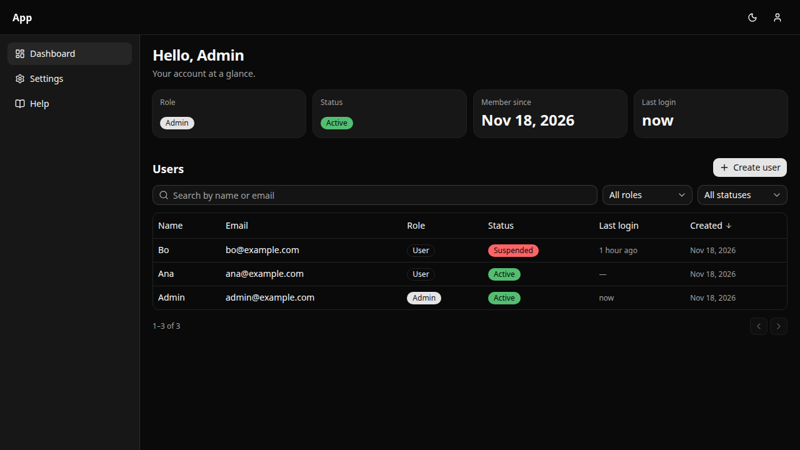

# full-stack-rust-nextjs-template

A starting point for web apps on **Rust**, **Next.js** and **PostgreSQL**, with the parts every app needs already built and tested: accounts with four ways to sign in, sessions, roles and permissions, an admin user list with an audit log, light and dark themes, a help page, deploy files, and the rules that keep a project consistent when people and AI agents work on it together.

<picture>
  <source media="(prefers-color-scheme: light)" srcset="docs/images/dashboard-light.png">
  
</picture>

## What is in it

- **Rust API** (axum, sqlx), the only backend:
  - **Sign-in**: email and password, a 6-digit code mailed through Resend, a Solana wallet signature (Sign-In-With-Solana), or Google and GitHub (OAuth with PKCE). Each account uses one method and can switch; an admin can move someone who lost their wallet or provider account to a password or codes.
  - **Sessions** in the database (only token hashes are stored), "log out everywhere", login throttling per email and per IP that holds under parallel requests, and answers that never reveal whether an email has an account.
  - **Registration** `open`, `approval` (an admin approves new users) or `closed`.
  - **Roles and permissions**: routes ask for a permission, never a role. Adding one is one line.
  - **User management** with search, filters, sorting and paging, and an audit log written in the same transaction as each change.
  - **OpenAPI** generated from the routes, an admin CLI, hourly clean-up that is safe with several API instances, Sentry (optional).
- **Next.js UI** (React 19, Tailwind v4, shadcn on Base UI, TanStack Query): a page for every feature above, a typed API client generated from the Rust API, light and dark themes, form checks with the API's rules, and reusable components with a showcase page. No server logic and no secrets.
- **PostgreSQL** with reversible migrations built into the API binary.
- **Deploy** to one Ubuntu server: Caddy with HTTPS and security headers, systemd with hardening, daily backups, a GitHub Actions workflow and one-command rollback.
- **Docs** in `docs/`: how the system works (the app also serves these on its Help page), the rules, and the bug report and feature request templates.

## Built to work with AI agents

The repository is set up so Claude Code (or a person new to it) can work on it without guessing:

- `CLAUDE.md` is the briefing: the map, the commands and the hard rules. `web/CLAUDE.md` does the same for the UI.
- `docs/rules/` says where code goes, how the database changes, how the UI looks and how commits read. Tests enforce several rules: every error code has words in the web and a row in the docs, colours come from theme tokens and pass a contrast check, every migration goes down and up again.
- `docs/system/` describes the app as it is. When a page and the code disagree, the code wins and the page is fixed in the same change.
- `skills/` holds two Claude Code skills: `app-api` signs in to the running app and calls its API (users, health, help pages), and `app-dev` takes a bug or a feature through the workflow below and can read and post to a team's Telegram report chat.

## How work is done

Every change starts as a document in `docs/`, from a template in `docs/rules/`:

1. A **bug report** (something does not work) or a **feature request** (something is missing).
2. The developer or the agent verifies it, writes a proposal, and asks the owner what only the owner can decide.
3. The owner answers and approves, in the document.
4. The work is split into tasks and implemented with tests until `scripts/check.sh` passes.
5. The owner checks the result; the document moves to `docs/archived/`.

An agent never approves, never answers for the owner and never commits unless asked. The full workflow is in `docs/rules/development.md`.

## Requirements

- Rust (stable, 1.94+): https://rustup.rs
- Node 26 and npm: `nvm install 26`
- PostgreSQL 16+ running locally, and a user that can create databases

## Start

```bash
# 1. Make it yours (once, right after cloning)
scripts/rename.sh my-project

# 2. Set DATABASE_URL in .env (the first run of setup creates .env from .env.example)
scripts/setup.sh            # creates the database, runs migrations, asks for the first admin (saved to .env for skills/app-api), installs the web
scripts/dev.sh              # API on http://127.0.0.1:8080, web on http://127.0.0.1:3000
```

Open http://127.0.0.1:3000 and log in as the admin you created. In development, sign-in codes are written to the API's log instead of mailed, and http://127.0.0.1:3000/components shows every component.

## Layout

```
crates/core       config, error codes, extractors, request id
crates/db         pool, migrations, shared query helpers
crates/auth       passwords, sign-in codes, wallet signatures, PKCE, session tokens, permissions
crates/mail       sends email (Resend, or the log in development)
services/api      the HTTP API and the admin CLI (app-api)
migrations/       SQL, built into the API binary
config/app.toml   non-secret settings
web/              the Next.js UI
deploy/           Caddy, systemd units, backup and release scripts, server guide
docs/             system docs (shown on the Help page), rules, templates, bug reports, feature requests
skills/           Claude Code skills
scripts/          setup, dev, check, rename
```

## Everyday commands

| Command | Does |
|---|---|
| `scripts/dev.sh` | runs the API and the web together |
| `scripts/check.sh` | everything CI runs: fmt, clippy, Rust tests, OpenAPI types, lint, typecheck, web tests, build |
| `scripts/check.sh security` | known vulnerabilities in the dependencies and secrets in the history; CI also runs it weekly |
| `cargo run -p app-api -- migrate` | applies new migrations |
| `cargo run -p app-api -- create-admin --email ... --first-name ... --last-name ...` | adds an admin |
| `cargo run -p app-api -- reset-password --email ...` | sets a password, signs the user out |
| `cd web && npm run api:types` | regenerates the web's API types after an API change |

## Settings

Secrets in `.env` (see `.env.example`), everything else in `config/app.toml`: app name, sessions, login throttling, registration mode, mail sender, code and wallet limits, the Google and GitHub client ids. Both are checked when the API starts, and a bad value stops it with the name of the setting. Details: `docs/system/config.md`.

## Removing what you do not need

- **Self-registration**: set `registration.mode = "closed"`; admins create users.
- **Google or GitHub**: leave its `client_id` in `config/app.toml` empty; the button and its routes go away.
- **Email codes**: off on a server without `RESEND_API_KEY`. To remove them for good, delete the `code` method's branches; `cargo check` and `npm run typecheck` point at each one.
- **Solana wallet sign-in**: always offered, and it reaches into the API, the database (`wallet_nonces`, `users.wallet`, the `wallet` login type), and the web (`WalletConnect` and four `@solana/*` packages). Removing it is a change of its own: write a feature request, and start from `grep -ril wallet services crates web/src migrations`.
- **The components page**: delete `web/src/app/components/` and `web/src/components/ComponentsShowcase/`.
- **The Help page**: delete `web/src/app/(app)/help/`, `web/src/components/HelpView/`, the `services/api/src/help/` folder, its `.merge` in `app.rs`, its module in `lib.rs` and its field in `state.rs`, and the Help entry in `web/src/lib/nav.ts`.
- **Sentry**: leave the DSNs empty, or remove `sentry` from the API and `@sentry/react` from the web.
- **The Telegram report chat**: leave `TELEGRAM_BOT_TOKEN` empty, or delete `skills/app-dev/scripts/telegram.mjs` and its section in `skills/app-dev/SKILL.md`.
- **The Claude skills**: delete `skills/` and `.claude/skills/`.

## Deploy

`deploy/README.md` takes a fresh Ubuntu server to a running app with HTTPS. After that, deploys are one click in GitHub Actions, and `sudo app-activate --rollback` returns to the previous release. A server refuses to start while `wallet.domain` or `oauth.public_url` still point at a laptop address.

## Working on it

Read `CLAUDE.md` and `docs/README.md`. Every change starts as a bug report or feature request in `docs/`, and `scripts/check.sh` must pass before it is done.

## License

Licensed under either of [Apache License 2.0](LICENSE-APACHE) or [MIT](LICENSE-MIT), at your option.
